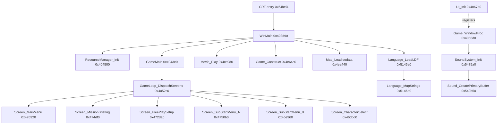

# Pizza Connection 2 — subsystem map

Target: `game/fastfood2.exe`, PE32 i386, SHA-256
`18cfd32e0ac5d6d98162ec016e058a2b51808d9ca49ebee933ce3166ff9922fd`.
Analysis: REA → Ghidra 12.2. This map is built from REA `open_binary`,
`analyze_function`, `read_bytes` and the full `decompile_all` export.

- 4,090 procedures in the provider inventory; 3,919 bodies decompiled.
- 13,277 direct call edges parsed from the pseudocode (a lower bound: virtual and
  indirect calls are not represented).
- 58 proposed names: **51 annotated in REA** and present in the pseudocode; 7 are
  proposed only (listed in `symbols.csv`).

## Startup and main flow

Observed lifecycle:

1. `0x54fcd4` initializes the MSVC runtime and calls `0x403d90` with the module
   handle and command line.
2. `WinMain` (`0x403d90`) registers the `Pizza Connection 2` window class, creates
   synchronization events/critical sections, parses the command line, initializes
   resources and language, plays the intro Bink movies, creates the main game
   object, loads the isometric map, and enters `GameMain` (`0x4043e0`).
3. `GameMain` resets screen state, calls `GameLoop_DispatchScreens` (`0x4052c0`),
   and shuts the active screens down afterwards.
4. `GameLoop_DispatchScreens` opens `mission.txt`, loads it line by line into a
   list, then loops on the exit event with a 10 ms wait. It dispatches screen
   states through a switch on `DAT_0056386c`.
5. `UI_Init` (`0x4067d0`) creates the 0x83e8-byte UI manager and registers
   `Game_WindowProc` (`0x4058d0`) as its message handler. `Game_WindowProc` is a
   201-basic-block window procedure: it handles `WM_*` messages and custom game
   commands, toggles sound via `SoundSystem_Init`, and contains the
   `pizza_shot%d.tga` screenshot branch.

## Screen state machine

`GameLoop_DispatchScreens` (`0x4052c0`) dispatches these observed switch cases:

| State | Handler | Proposed screen | Evidence |
|---|---|---|---|
| `0x15` | `0x476920` | `Screen_MainMenu` | `Pe_Startscreen.tga`, `TIMESFONT.fnt` |
| `0x16` | `0x474df0` | `Screen_MissionBriefing` | `PE_MISSIONSBRIEFING_*.tga`, mission text |
| `0x18` | `0x472da0` | `Screen_FreePlaySetup` | `Pe_Freies_Spiel.tga`, player/company fields |
| `0x19` | `0x4750b0` | `Screen_SubStartMenu_A` | `PE_SUB_STARTSCREEN.spr`, `TABPB01` buttons |
| `0x1b` | `0x46e960` | `Screen_SubStartMenu_B` | `PE_SUB_STARTSCREEN.spr`, `SL02_00`, separator |
| `0x1c` | `0x46dbd0` | `Screen_CharacterSelect` | `Pe_Charakterauswahl.tga`, gender/photo widgets |

Cases `0x17`, `0x1a` and `0x1d` call transition/cleanup helpers (`0x404af0`,
`0x4052a0`) rather than a screen constructor. The exact user-visible labels of the
two `PE_SUB_STARTSCREEN` menus are not established, so they are named `_A`/`_B`.

Other observed screen builders (not all are annotated):

| Address | Resource evidence | Interpretation |
|---|---|---|
| `0x433790` | `STATISTIKFILIALBILANZ.spr`, `BEWERTUNG_*.spr` | branch balance statistics |
| `0x43edb0` | `SK_PERSONAL.spr`, `PERSOPLAN.spr` | personnel/assignment screen |
| `0x46f9c0` | `Pe_Endergebnis_Punkte.tga` | end-result/score screen |
| `0x430fd0` | `STATISTIKBILANZBACK.spr` | statistics balance |
| `0x43e430` | `STATISTIKBACKSPRITE.spr` | statistics backdrop |
| `0x535fc0` | TGA fullscreen loader | loading/fullscreen image window |

## Resource and data layer

| Address | Name | Evidence |
|---|---|---|
| `0x404500` | `ResourceManager_Init` | allocates 0x1ac4 bytes; registers `sprites\`, `fonts\`, `pictures\`, `daten\` aliases |
| `0x401970` | `ResourceManager_Construct` | assigns vtable `0x55c2f0`, creates internal named lock |
| `0x401af0` | `Pak_Open` | opens a `ResourceFile-ID-7654` archive, reads/decodes the index |
| `0x401f30` | `Pak_DecodeIndex` | position-dependent index decoder |
| `0x402060` | `Pak_FindEntry` | binary-searches decoded entries by name |
| `0x402290` | `Resource_Open` | central opener, 18 call sites; resolves archive/filesystem path |
| `0x402750` | `Resource_Read` | reads bytes; handles memory-mapped and stream-backed entries |
| `0x402840` | `Resource_ReadLine` | CR/LF line reader used for `mission.txt` and `language.ldf` |
| `0x402990` | `Resource_Close` | closes stream entries |
| `0x4029d0` | `Resource_GetSize` | returns entry size |
| `0x402cf0` | `FileObject_Open` | file/resource object, vtable `0x55c2f4` |
| `0x5145a0` | `Language_LoadLDF` | opens `language.ldf`, reads it, builds string pointer table |
| `0x5146d0` | `Language_MapStrings` | copies parsed LDF strings into the globals used by UI text |
| `0x4ea440` | `Map_LoadIsodata` | opens `Isodaten.idx`, reads records, constructs map/tile objects |

Known content files: `language.ldf`, `Resources/main.pak`, `Resources/iso.pak`,
`Resources/movie.pak`, `Resources/sound.pak`, `Resources/update.pak`, plus loose
`Isokarten/*.iso`, `Isokarten/*.STY`, and `Isokarten/palette.db`.
The `.pak` format is now reversed — header, obfuscated index, 0x14-byte entries
and raw payload offsets are documented in `PAK_FORMAT.md`; `../tools/pak_tool.py`
can extract **and repack** archives. All 9,142 entries across the five paks were
extracted to `../extracted/`.

`language.ldf` is a flat `u32 count` + NUL-terminated cp1252 string table; its
layout and exact round-trip tool are documented in `LDF_FORMAT.md`.

Mission/campaign data is in `main.pak` as `daten/<city>.ini` for the ten cities
(London, Berlin, Madrid, Moscow, Paris, Rio, Rome, Sydney, Tokyo, New York).
`mission_data.csv` normalizes the city name, country, difficulty, goal IDs,
starting money/HQ, opponents and briefing text. City maps are the loose
`Isokarten/<city>.iso` files.

Save-game paths observed in the executable:
`save\games\save_%03d.piz`, `save\games\auto_%03d.piz`, `save\piz\%s.piz`,
`save\menu\%s.men`.

| Address | Name | Evidence |
|---|---|---|
| `0x487520` | `SaveGame_Write` | builds the 0xF0 header (title/company/city/slots/timestamp) |
| `0x487b50` | `SaveGame_Serialize` | payload section graph; start `0x2E`, end `0x2A` |
| `0x4a1570` | `SaveGame_ReadHeaderEntry` | reads 0xF0 bytes, checks magic `0x13738317` |
| `0x4a14c0` | `SaveGame_CompareTime` | sorts saves by `SYSTEMTIME` |
| `0x4a1940` | `SaveGame_Scan` | adds autosave and manual saves to the list |

The `.piz` header and save-list layer are documented in `PIZ_FORMAT.md`; the
payload is a graph of subsystem serializers and is **not decoded yet**.

## Rendering, movies, audio, input

| Address | Name | Evidence |
|---|---|---|
| `0x537f20` | `DirectDraw_Init` | calls `DirectDrawCreate`; configures display |
| `0x537230` | `Window_Construct` | window/surface constructor, vtable `0x55c814` |
| `0x52e8f0` | `Dialog_Construct` | rectangle dialog, vtable `0x55c808` |
| `0x52ae20` | `MovieWindow_Construct` | Bink window, vtable `0x55c7b0`, `BinkOpen` |
| `0x4ce9d0` | `Movie_Play` | creates movie window, plays `s2000s.bik` / `intro_bombe*.bik` |
| `0x53c7f0` | `Sprite_Load` | parses `.spr`, vtable `0x55c82c` |
| `0x535fc0` | `FullscreenImage_Load` | loads TGA/fullscreen image |
| `0x5475a0` | `SoundSystem_Init` | DirectSound init, opens `resources\sound.pak`, logs success/failure |
| `0x542b50` | `Sound_CreatePrimaryBuffer` | creates primary buffer, logs `creating primary buffer` |
| `0x4894d0` | `Input_MouseHandler` | mouse movement/buttons, cursor and input state |
| `0x4058d0` | `Game_WindowProc` | window procedure; also handles screenshot hotkey |

The engine is DirectDraw + Bink with a custom sprite/font/animation/TGA resource
layer. `.spr` files are parsed by `Sprite_Load`; `.fnt`, `.tga` and `.ani` are
loaded through the same resource manager.

## UI object model

| Address | Name | Evidence |
|---|---|---|
| `0x4067d0` | `UI_Init` | creates UI manager, registers `Game_WindowProc`, sets colors/font |
| `0x523bb0` | `UI_CreateWindow` | creates 0x2c8-byte window, registers by ID; 113 call sites |
| `0x528040` | `UI_FindWindowByID` | linear scan of UI window table by numeric ID |
| `0x52f850` | `UI_AddText` | creates text element bound to a font; 112 call sites |
| `0x52f5b0` | `UI_AddImage` | creates image element from sprite; 110 call sites |
| `0x531850` | `UI_AddSprite` | loads sprite and attaches it to a window |

Recovered vtable clusters (`vtables.csv`):

| Vtable | Class | Constructor |
|---|---|---|
| `0x55c5d0` | `Game` | `0x4e64c0` |
| `0x55c5a4` | `GameSubclass` | `0x4e42f0` |
| `0x55c7b0` | `MovieWindow` | `0x52ae20` |
| `0x55c814` | `Window` | `0x537230` |
| `0x55c808` | `DialogWindow` | `0x52e8f0` |
| `0x55c860` | `DirectSoundManager` | `0x542b50` |
| `0x55c82c` | `Sprite` | `0x53c7f0` |
| `0x55c2f0` | `ResourceManager` | `0x401970` |
| `0x55c2f4` | `FileObject` | `0x402cf0` |

## Hot functions (by direct in-degree)

| Address | Name | In-degree | Role |
|---|---|---|---|
| `0x54dd78` | `Mem_Free` | 732 | CRT/HeapFree wrapper |
| `0x4017f0` | `IDMap_Lookup` | 673 | direct-index/binary-search ID map |
| `0x54e221` | `operator_new` | 263 | allocator |
| `0x488be0` | *(unnamed)* | 220 | returns slot from a 6-entry array at `this+0x200` |
| `0x54dd83` | `String_Format` | 172 | sprintf-like formatting |
| `0x52f9b0` | *(unnamed)* | 155 | UI element setter |
| `0x401480` | `List_Node_Destroy` | 146 | frees a two-pointer node |
| `0x52f910` | *(unnamed)* | 146 | UI element setter |
| `0x528040` | `UI_FindWindowByID` | 139 | UI table lookup |
| `0x531850` | `UI_AddSprite` | 117 | sprite UI element |
| `0x523bb0` | `UI_CreateWindow` | 113 | create/register UI window |
| `0x52f850` | `UI_AddText` | 112 | text UI element |
| `0x4014b0` | `List_Add` | 111 | growable list append |
| `0x52f5b0` | `UI_AddImage` | 110 | image UI element |
| `0x401340` | `CS_Leave` | 109 | critical-section leave |
| `0x401320` | `CS_Enter` | 108 | critical-section enter |

Full graph: `callgraph.json` (nodes, direct call edges, in-degree, size).
WinMain neighborhood: `callgraph-winmain.dot`. Top 80: `top-hubs.csv`.

## Confidence and unknowns

- **Observed**: addresses, call edges, imports, string/resource references,
  vtable assignments, function sizes and switch cases.
- **Inferred**: human-readable names and class roles. Names are based on the
  resources and APIs each function uses, not on original symbols.
- **Not annotated in REA** (proposed only): `CRT_Entry` `0x54fcd4`,
  `ResourceManager_Construct` `0x401970`, `Game_Construct` `0x4e64c0`,
  `Movie_Play` `0x4ce9d0`, `Screen_StatisticsBranchBalance` `0x433790`,
  `Screen_Personnel` `0x43edb0`, `Screen_EndResults` `0x46f9c0`. These still
  appear as `FUN_*` in the pseudocode.
- The 171 imported functions are stubs with no body.
- Virtual/indirect calls are excluded from the call graph, so 13,277 edges are a
  lower bound.
- This is static analysis; no runtime behavior was observed.
